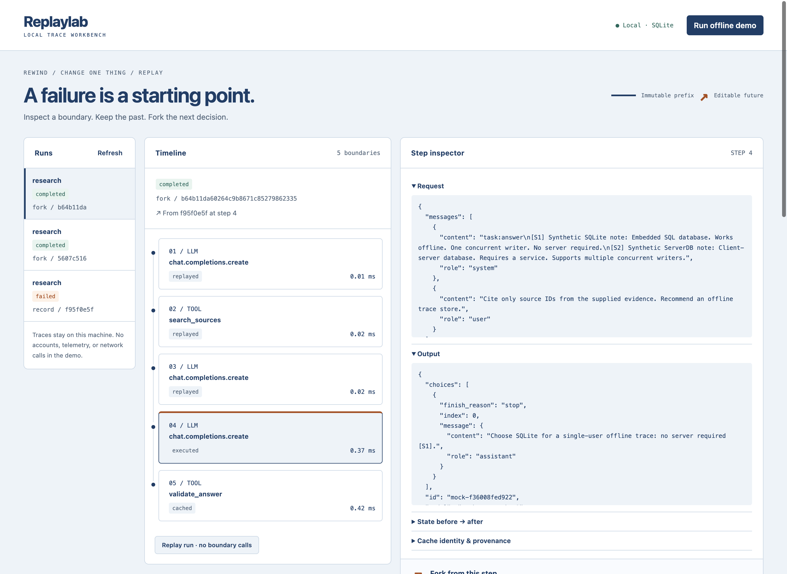
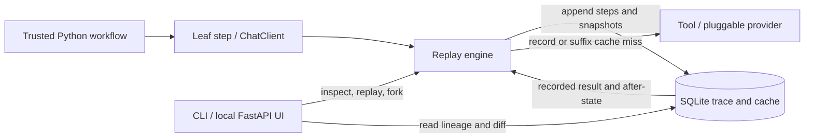

# replaylab

Deterministic replay, a content-addressed cache, and SQLite run lineage for Python agents.

- Reproduce a failure without repeating earlier tool effects or provider calls.
- Change one prompt, model, parameter set, or tool result; execute the remaining workflow.
- Compare the original and fork, including requests, outputs, errors, and state snapshots.

**The offline demo repairs a failed run with 1 provider call instead of the original 3.**
The LLM is a pluggable boundary, not the replay engine.

```sh
uv sync --locked --python 3.12
uv run replaylab demo --db .replaylab/readme.sqlite
```

Captured on a fresh trace database:

```text
replaylab / offline research repair
Original: failed at step 4
Fork:     completed
Provider calls: original=3, fork=1
Prefix replayed: 3/3 steps (zero boundary calls)
Step  Original                       Fork
   1  llm                            replayed / unchanged
   2  tool                           replayed / unchanged
   3  llm                            replayed / unchanged
   4  error                          executed / changed
   5  —                              executed / added
Answer: Choose SQLite for a single-user offline trace: no server required [S1].
```

The mock provider is deterministic and uses synthetic evidence. It is not an LLM-quality
benchmark. Reusing this database can produce additional suffix cache hits and fewer calls.
Use `--json` for unique run IDs and machine-readable traces; UUIDs and timestamps are
metadata, not workflow inputs. There are no stochastic demo decisions to seed.

## The problem

An agent gets most of a run right, then fails. Rerunning everything repeats tool effects,
pays for the same LLM requests, and makes the failure harder to isolate. Ordinary logs
show what happened but cannot substitute recorded results back into the application.

Replaylab restarts a trusted workflow, verifies its recorded prefix by position and
request hash, restores boundary state, and injects cached results. A fork changes one
boundary without modifying the original. Runs and their parent links stay in SQLite.

## Quickstart

Requires [uv](https://docs.astral.sh/uv/) and Python 3.12; uv can provision Python.
Install dependencies once. The default demo, tests, and UI need no API key or network
at runtime. From this repository:

```sh
uv sync --locked --python 3.12
uv run replaylab demo
uv run replaylab serve
# Open http://127.0.0.1:8765
```

Click **Run offline demo**, select the failed fourth step, and replace its prompt with:

```text
Cite only source IDs from the supplied evidence. Recommend an offline trace store.
```

Click **Fork & re-execute**. The prefix is replayed; the changed result appears alongside
the failure. The same editor supports models and generation parameters. Tool steps
accept a replacement JSON result and after-state. **Replay run** reproduces a recorded
run without executing any provider or tool boundary.



[Side-by-side diff](evidence/diff.png) · [Mobile layout](evidence/mobile.png)

## Architecture



Python 3.12 keeps decorators, context-local execution, JSON, and SQLite in one runtime.
FastAPI serves a small vanilla-JavaScript frontend. No separate database, frontend build,
LLM framework, vector store, or background service is required. Runtime dependencies
are FastAPI, Uvicorn, and HTTPX; the deterministic provider makes no HTTP requests.

## SDK

Decorate leaf functions, not orchestration functions. Arguments, results, and state
must be JSON-compatible. Put mutable workflow state in `current_session().state`.

```python
from replaylab import Engine, Fork, Store, current_session, step
from replaylab.providers import ChatClient, MockProvider

client = ChatClient(MockProvider())


@step(name="lookup", version="1")
def lookup(topic: str) -> dict:
    current_session().state["topic"] = topic
    return {"source": "synthetic note", "text": "SQLite works offline."}


def app(data: dict) -> dict:
    note = lookup(data["topic"])
    return client.chat.completions.create(
        model="mock-v1",
        messages=[{"role": "user", "content": str(note)}],
        temperature=0,
    )


store = Store(".replaylab/sdk.sqlite")
engine = Engine(store)
data = {"topic": "offline tracing"}
original = engine.run(app, data)
forked = engine.run(
    app,
    data,
    source=original,
    fork=Fork(2, {"prompt": "Explain offline tracing.", "params": {"temperature": 0.2}}),
)
replayed = engine.run(app, data, source=forked, mode="replay")
assert store.get_run(replayed)["status"] == "completed"
```

`Engine.run` returns a run ID even when the workflow fails. Inspect `store.get_run(id)`
for status/error and `store.steps(id)` for the timeline. Invalid execution options fail
before a run is created. The compatible call shape returns JSON dictionaries, not
OpenAI SDK objects. It supports text messages and complete, non-streaming responses.

A tool-result intervention uses `Fork(position, {"tool_result": value})`. Its default
after-state is the incoming state; include `"state_after": {...}` to replace it explicitly.
Bump a tool's `version` when its implementation or external data contract changes.

### Plug in a real provider

```python
import os
from replaylab.providers import ChatClient, OpenAIProvider

client = ChatClient(
    OpenAIProvider(
        base_url=os.environ["OPENAI_BASE_URL"],
        api_key=os.environ["OPENAI_API_KEY"],
    )
)
# Inside your Engine workflow:
# client.chat.completions.create(model="your-model", messages=[...])
```

[examples/agent.py](examples/agent.py) is an executable SDK integration. It defaults to
the mock provider and requires explicit `REPLAYLAB_PROVIDER=openai` before network calls.
The HTTP adapter is tested against a controlled transport; no paid provider was used
for the measurements in this repository. It has a request timeout and no automatic retries.

```sh
PYTHONPATH=. uv run replaylab run examples.agent:workflow --input '{"topic":"offline tracing"}'
# Make a custom workflow available to the UI:
PYTHONPATH=. uv run replaylab serve --app examples.agent:workflow
```

### CLI

```sh
uv run replaylab runs
uv run replaylab inspect RUN_ID
uv run replaylab inspect RUN_ID --step 4
uv run replaylab fork RUN_ID --step 4 --edit '{"prompt":"Cite only source IDs from the supplied evidence."}'
uv run replaylab replay FORK_ID
uv run replaylab diff ORIGINAL_ID FORK_ID
```

Every trace command accepts `--db PATH`. Custom replays/forks require explicit
`--app module:function` registration. Database strings never cause code imports.
`run`/`replay`/`fork` exit with 0 for completed runs, 1 for recorded workflow failures,
and 2 for invalid CLI/configuration input. Failed runs remain inspectable.

## Determinism contract

| Mode | Earlier boundaries | Current boundary / suffix | Provider or tool calls |
|---|---|---|---|
| Record | Execute | Execute; successful results populate cache | Always |
| Replay | Verify source hashes and restore results/state | Missing, changed, or shortened traces fail closed | Never |
| Fork at N | Replay positions before N | Apply edit at N; cache hit or execute suffix | Only suffix cache misses |

SHA-256 covers canonical JSON with kind, boundary name/version, provider namespace,
request arguments, and incoming state. Edited boundaries also retain their effective
intervention and pre-edit hash, so a fork can itself be replayed or forked. Failed
boundary results are not placed in the shared cache. A recorded failure can still be
reproduced from its source trace as `RecordedFailure`.

Full replay also verifies final output and does not allow a swallowed source failure
to become a successful run. This is deterministic **boundary replay**, not a promise
that arbitrary Python code, live model sampling, or external services are deterministic.

## Results

Measured with these commands; raw output is under [evidence/](evidence/):

```sh
uv run ruff check .
uv run ruff format --check .
uv run pytest -q --cov=replaylab --cov-report=term-missing
uv run replaylab benchmark --trials 50
```

- **75 tests passed; 96% statement coverage.** SQLite and FastAPI use real integration
  tests. The only fake external service is the provider/network boundary. CLI tests
  launch the installed executable; child-process coverage is included.
- Fresh database per benchmark trial; no artificial model delay. Measured on macOS
  arm64, Python 3.12.15. Database initialization is excluded; actual SQLite writes are included.

| Mode | Median ms | p95 ms | Total provider calls |
|---|---:|---:|---:|
| Record to failure | 2.877 | 3.726 | 150 |
| Cold fork to completion | 4.714 | 5.486 | 50 |
| Full successful replay | 4.425 | 5.526 | 0 |
| Repeat identical fork | 4.756 | 6.272 | 0 |

The benchmark replayed 150 prefix boundaries. Cold forks used 50 provider calls versus
150 for the original runs; full replay and identical warm forks used zero. Forks and
replays are **not faster than this instant mock**: they write a successful, longer trace
and read stored results. The measured benefit is avoided boundary execution, not an
invented end-to-end latency speedup. Live-provider latency and cost are unmeasured.
Timings depend on hardware and load; rerunning reproduces the workload and call counts,
not exact milliseconds.

## What's hard here

- **Skipping effects without skipping control flow.** Re-enter the workflow, substitute
  leaf results, restore after-state, and reject hash/order/output drift.
- **Keeping cache hits valid.** Include model, parameters, boundary version, provider,
  and incoming state. Restore cached output and state together; do not cache errors.
- **Branching a branch.** Preserve the unpatched request hash and effective edits at
  each boundary. Otherwise replaying a repaired run silently loses its intervention.

## Design decisions and trade-offs

- SQLite keeps installation local and transactions inspectable. WAL handles short
  concurrent writes; this is not a distributed job scheduler.
- Re-entry avoids unsafe serialized Python stacks. It requires pure orchestration and
  synchronous leaf boundaries instead of arbitrary suspension/resumption.
- Complete JSON snapshots simplify state restoration and diffing. Copying prefixes
  costs storage; large payloads and huge histories need a different storage layout.
- Record mode intentionally bypasses cache. Use it when provider freshness matters.
  A fork trades freshness for exact content-addressed reuse.

[DESIGN.md](DESIGN.md) covers contracts, failure behavior, security, rejected alternatives,
and interview notes. [evidence/README.md](evidence/README.md) maps proof to acceptance criteria.
Installation, lint, tests, CLI/module demos, and wheel/sdist builds also passed in a
[clean local filesystem clone](evidence/clean-clone.txt).

## Limitations and safety

- Synchronous, sequential, JSON-only boundaries. No nested decorated steps, async agent
  DAGs, streaming, multimodal messages, stack checkpoints, or process resurrection.
- Instrument every effectful boundary. Globals, clocks, random values, environment
  reads, and argument mutation outside `Session.state` are not automatically restored.
  Do not make unrelated side effects in orchestration code.
- Fork suffixes can execute tools again. Use idempotent tools or a safe test environment;
  replaylab is not a sandbox, transaction rollback system, or approval gate.
- Single-user local UI, no authentication. Loopback binding, Host/Origin checks, CSP,
  and text-only rendering are defense in depth, not permission to expose the port.
- Traces are plaintext and can contain private prompts or tool outputs. No automatic
  redaction or encryption. API keys are sent in HTTP headers, never stored by the adapter.
- HTTP cache namespaces distinguish endpoints, not API-key accounts. Use separate
  databases or account-specific provider namespaces across accounts/tenants.
- Boundary versions are caller-managed; the engine does not fingerprint tool source
  code or changing remote data. Interrupted processes may leave runs marked `running`;
  these cannot be replayed or forked as immutable sources.
- The run list loads the local history and snapshots in full. Large histories are not
  load-tested. Schema versions other than the current local format are rejected.
- No paid-model quality, token-cost, multi-user security, or cross-platform performance
  claims. The offline mock is a rule-based fixture with zero reported token usage.

## Roadmap

Stable logical IDs for async/DAG boundaries; paginated trace reads and blob-backed
payloads; explicit retention/redaction policies. These are not implemented.

## Development

```sh
uv sync --locked --python 3.12
uv run ruff check .
uv run ruff format --check .
uv run pytest -q --cov=replaylab --cov-report=term-missing
uv build
```

CI runs lint, format checks, tests, and the offline demo. The project has only been
committed locally; the workflow has not run on a hosted CI service. Code and synthetic
fixtures were written for this project, without employer code, prompts, or datasets.

MIT licensed. Author: Goutham Madineni.
