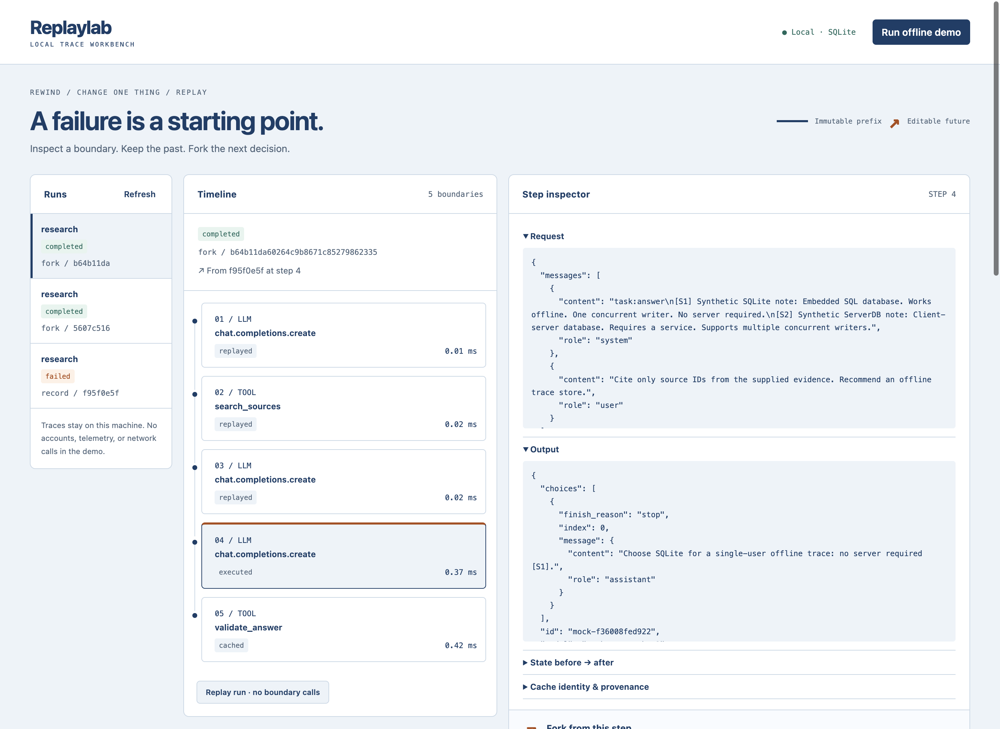
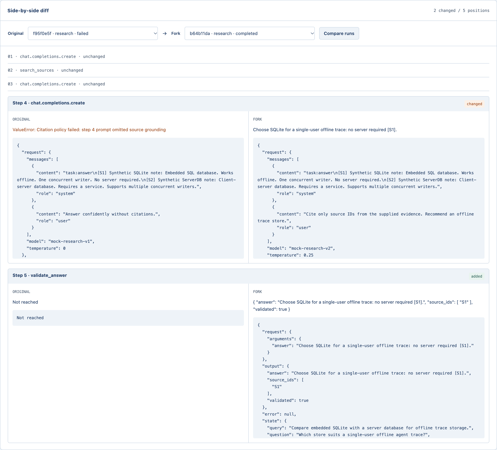

# Verification evidence

All fixtures are synthetic. No paid provider or employer data was used.

| ID | Proof delivered | Artifact | Result |
|---|---|---|---|
| EC-1 | Real SQLite integration | `tests/test_demo.py::test_demo_fails_at_four_then_repairs_without_repeating_prefix`; `tests/test_engine.py::test_record_replay_restores_state_without_tool_calls` | Failure at fourth boundary; before/after-state retained |
| EC-2 | Real SQLite integration | `tests/test_engine.py::test_prefix_mismatch_fails_without_calls`; `tests/test_contract_edges.py::test_replay_missing_suffix_never_executes_new_boundary`; `tests/test_replay_output.py` | No provider/tool calls on replay; changed requests/results fail closed |
| EC-3 | Integration + browser journey | `tests/test_providers.py::test_compatible_wrapper_prompt_model_params_fork`; `tests/test_engine.py::test_fork_tool_result_replays_prefix_and_reexecutes_suffix`; screenshots below | Every requested edit type exercised |
| EC-4 | Captured CLI output | [demo.txt](demo.txt), `uv run replaylab demo --db .replaylab/readme.sqlite` on a fresh database | Original failed, repaired fork completed; earlier boundaries replayed |
| EC-5 | Running browser journey | [workbench.png](workbench.png), [diff.png](diff.png), [mobile.png](mobile.png) | Timeline, inspector, fork form, result diff, and mobile rendering exercised |
| EC-6 | HTTP transport integration | `tests/test_providers.py::test_http_adapter_sends_openai_contract_and_no_key_in_trace`; error/malformed-response tests | Correct endpoint/body/auth; provider contract errors rejected |

## Browser journey

Run `uv run replaylab serve`, then open the loopback address printed by the CLI.
The screenshots were captured in a dedicated Chromium browser against a running Uvicorn
server, not rendered mockups. Desktop viewport: 1440 × 1050; mobile: 390 × 844.

1. Click Run offline demo. The original failed run selects its fourth boundary.
2. Replace the prompt with the fixed prompt in the main README, model with
   `mock-research-v2`, and parameters with `{"temperature":0.25}`. Fork the run.
3. Observe completed fork, selected STEP 4, and `2 changed / 5 positions` in the diff.
   The original shows a citation-policy error; the fork shows the sourced answer.
4. Select the final validation tool; replace its JSON result with a human-corrected
   synthetic answer and supply an explicit after-state. Fork again. Observe completed
   run, selected STEP 5, and `1 changed / 5 positions`.
5. Replay that fork. Observe completed replay and `0 changed / 5 positions`.
6. Inspect browser errors: no entries. At the mobile viewport, document scroll width
   and inner width were both 390 pixels; no horizontal overflow was observed.

## Automated results

`uv run pytest -q --cov=replaylab --cov-report=term-missing`:
[tests.txt](tests.txt). Subprocess instrumentation includes installed CLI executions.
`uv run ruff check .` and `uv run ruff format --check .` passed.
Frontend script syntax was checked with `node --check src/replaylab/static/app.js`.

`uv run replaylab benchmark --trials 50`: [benchmark.json](benchmark.json).
No random data or simulated latency. Each trial owns a fresh database. Real timings
vary; boundary/provider call counts are deterministic. UUIDs and timestamps are unique
trace metadata and intentionally excluded from human demo output and semantic diffs.

## Clean clone

[clean-clone.txt](clean-clone.txt) records local-filesystem cloning, locked installation,
lint/format checks, tests with coverage, both executable/module demos, and artifact builds.
The initial clone caught unformatted README Python fences; the correction was committed,
then the remaining checks passed. No remote was contacted. Both wheels and source
distributions built; the wheel includes the frontend HTML, CSS, and JavaScript assets.

## Evidence limits

The HTTP adapter used a controlled HTTPX transport, not a live paid model. Browser
verification is a recorded manual journey; it is not claimed as a CI browser suite.
No large-history, multi-user, process-kill, or async/DAG load test was performed.
